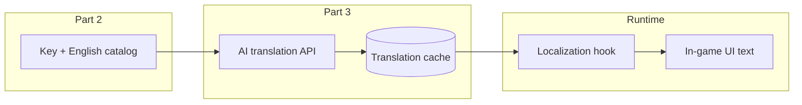

# Valheim Irish Language Learning Mod — Project Overview

A BepInEx mod distributed via Thunderstore that replaces in-game **text** with Irish (Gaeilge) translations produced by an AI translation service, with an optional learner mode that appends the original English in brackets. Audio (voices, music, SFX) is out of scope.

**Target environment:** Steam Valheim, existing Thunderstore mod manager workflow, dedicated server (same stack as today — no changes required to hosting or manager setup).

**Scope for this document:** This mod only. Additional language or learning mods may follow later but are not designed for here.

---

## Goals

| Goal | Description |
|------|-------------|
| Play in Irish | Menus, tooltips, item names, quest/dialog UI text, and other surfaced strings appear in Irish during normal play. |
| Learn while playing | Optional toggle shows the English source after each translated line, e.g. `Dia dhuit [Hello]`. |
| Maintainable pipeline | Strings can be re-extracted after game or mod updates; translations can be regenerated or cached incrementally. |
| Multiplayer-safe | Behavior is consistent on dedicated servers when clients run the mod (exact sync rules TBD — see open questions). |

---

## Three-part work breakdown

### Part 1 — Valheim modding foundation (BepInEx / Thunderstore)

**Objective:** Ship a minimal, correctly packaged plugin that loads in single-player and on a dedicated server using your current Thunderstore setup.

**Typical deliverables:**

- BepInEx 5.x plugin project (C#, .NET version matching Valheim’s supported BepInEx stack).
- `Plugin` entry with GUID, name, version; dependency on game assemblies via NuGet/refs (e.g. Valheim modding templates or Jötunn if adopted for helpers — decision open).
- Thunderstore manifest: `manifest.json`, `README.md`, icon, zipped `BepInEx/plugins/...` layout.
- Version pinning against a tested Valheim build; document game version in README.
- Config file via BepInEx `Config` (e.g. API endpoint, API key path, cache folder, toggle defaults).

**Success criteria:** Plugin loads without errors; empty or stub hook proves injection point; package installs via mod manager on client and server.

**Notes:**

- Dedicated server usually needs the same server-side plugins as clients for gameplay mods; confirm whether this mod is **client-only** (UI) or also patches server-visible strings.
- Follow Thunderstore naming, dependencies (`denikson-BepInExPack_Valheim`, etc.), and semver conventions.

---

### Part 2 — Discover and extract in-game text strings

**Objective:** Build a reliable inventory of localizable strings and a repeatable way to pull them from the game (and keep the list current across patches).

**Likely investigation areas (to validate in implementation):**

- Valheim / Unity localization: `Localization` API, language codes, JSON or asset-backed translation tables under `Valheim_Data` or embedded in assets.
- Runtime vs data files: which strings come from `Localization.instance.GetText("$key")` vs hardcoded or mod-added content.
- UI layers: uGUI/TextMeshPro components, custom UI from base game and from other mods (other mods may be out of scope initially).
- **Extraction strategies:**
  - **Static:** Parse shipped localization files / assets in the install directory (good for batch baseline).
  - **Dynamic:** Harmony patch or hook on `Localization.GetText` (and related) to log keys and English values at runtime while playing through content (good for completeness).
  - **Hybrid:** Static baseline + runtime diff for missed keys.

**Deliverables:**

- Documented map of where strings live (paths, formats, key conventions).
- Extraction tool or in-mod “dump mode” (config flag) writing `keys.json` / CSV with stable IDs.
- Stable **string identity** scheme (prefer game localization keys over raw English text) for cache lookup and updates.

**Success criteria:** A machine-readable catalog of keys and English source text covering menus, items, skills, biome names, boss text, etc., with a defined process to refresh after a Valheim update.

---

### Part 3 — AI translation, cache, and in-game injection

**Objective:** Translate catalog strings to Irish via an external AI service, persist results, and serve Irish text in-game with optional English suffix.

**Pipeline (conceptual):**

**Translation layer:**

- Batch translate offline or on first encounter (lazy); prefer **offline batch** for cost control and reviewability.
- Cache by `(key, source_hash)` or similar so English edits from patches invalidate only affected entries.
- Irish locale: target **Gaeilge** (`ga`); decide standard (e.g. Caighdeán Oifigiúil) and note in README for contributors.
- Service choice open (OpenAI, Anthropic, DeepL, local model); requires API key handling via BepInEx config (never commit secrets).

**Injection layer:**

- Harmony patch (or wrapper) on text resolution: if mod enabled and cache has entry, return Irish string (plus optional bracket suffix).
- **Learner mode (keybind):** When enabled, append ` [original English]` to the displayed string (or only for “sentence-like” strings — heuristic TBD).
- Config: default on/off for learner mode; rebindable key via BepInEx / Unity Input or game-style config entry.

**Success criteria:** In-game text displays in Irish; toggling learner mode shows English in brackets; game remains playable; missing translations fall back to English with optional log warning.

---

## Learner mode — keybind toggle (product detail)

| Behavior | Detail |
|----------|--------|
| Default | Irish only (no brackets). |
| When enabled | Each resolved string becomes `{irish} [{english}]` (exact formatting configurable). |
| Control | User-defined keybind; persisted in mod config. |
| Scope | Text only; no change to audio. |

**UX considerations:** Brackets may clutter tight UI (inventory grids, short labels). Open question: apply learner suffix only to “long” strings or dialog, not item names (see below).

---

## Explicit non-goals

- Voice-over, music, or any audio localization.
- Supporting multiple target languages in one mod (Irish only for v1).
- Translating other players’ chat or user-generated content.
- Guaranteeing compatibility with every third-party mod (best-effort for base game first).

---

## Open questions

1. **Client vs server:** Is all targeted text client-side UI, or do some strings originate server-authoritative? Does the dedicated server need the plugin only for parity, or also to serve data?
2. **Localization keys:** Does Valheim expose stable keys for all player-facing text, or will some entries require hashing English body text?
3. **Learner mode scope:** Brackets on every string vs dialog/description only — user preference vs UI clutter.
4. **Translation quality:** Single AI pass vs glossary for proper nouns (Yagluth, Mistlands, Eikthyr, etc.) and game terms (e.g. “Fine wood”).
5. **Legal / ToS:** AI provider terms; storing and redistributing translation cache on Thunderstore (if shipped) vs per-user generation only.
6. **Patch churn:** Process when Iron Gate updates English source — auto-detect `source_hash` mismatch and re-queue translation.
7. **Irish standard:** Which register (formal CO, dialect notes) and handling of pluralization / gender where English is ambiguous.
8. **Performance:** Size of cache, load at startup vs lazy load, impact on `GetText` hot path.
9. **Modding helpers:** Raw BepInEx + Harmony only vs Jötunn / other libraries for config and localization helpers.

---

## Suggested next steps

1. **Spike Part 1:** Create empty BepInEx plugin; verify load on local Valheim and dedicated server with current Thunderstore stack; publish internal test package.
2. **Spike Part 2:** Trace one menu and one item tooltip from UI to `Localization.GetText`; dump keys for main menu and inventory; document file locations in install dir.
3. **Define string catalog format:** e.g. `strings/en.json` keyed by localization key with English value and metadata.
4. **Choose translation provider** and run a 50–100 string pilot batch; review Irish quality for game context.
5. **Implement minimal hook:** Replace text for one screen (main menu) from a hand-edited Irish JSON before wiring AI.
6. **Add learner keybind** and config; playtest readability in combat and inventory.
7. **Automate extract + translate + pack** script for repeatable builds when Valheim updates.

---

## Risks and mitigations

| Risk | Mitigation |
|------|------------|
| Game update breaks hooks | Pin tested versions; monitor Valheim patch notes; small surface-area patches. |
| Incomplete string capture | Hybrid extract + runtime logging; community reports missing keys. |
| AI mistranslation breaks immersion | Glossary file; optional human review for v1 cache; fallback to English. |
| UI overflow with long Irish + brackets | Shorter learner format; exclude categories; TMP overflow settings (limited). |
| API cost at full catalog size | Batch once; ship cache with mod or download on first run. |

---

## References to gather during Part 1–2

- [Thunderstore Valheim](https://thunderstore.io/c/valheim/) — manifest examples and dependencies.
- BepInEx Valheim pack and official/community modding wikis.
- Valheim modding Discord / GitHub templates for `.csproj` and deploy paths.
- Harmony documentation for patching localization methods.

---

*Document status: initial overview for project planning. Update as spikes answer open questions.*
